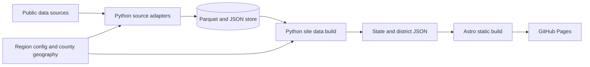

# Texas Ag Dashboard architecture

The dashboard is a static site with a scheduled data pipeline. Python fetches public data, keeps a history of observations, and turns that history into JSON for Astro. Astro reads the JSON during the build and publishes HTML, SVG, share images, and JSON to GitHub Pages. A page visit uses the published snapshot. Start with the [Quickstart](../QUICKSTART.md) to run it locally.

## Geography and configuration

Texas is the configured region. County FIPS codes join observations, geography, and county cards across the pipeline. The county table supplies names, district membership, centroids, and land area for all 254 counties. Each of the 15 NASS agricultural statistics districts has a page. The five featured districts appear in the header and first on the Texas page. A district's `crops` list selects which statewide crop series appear on its page. [Region loader](../kad/config.py) · [Texas configuration](../regions/tx.yaml) · [County table](../regions/tx-counties.csv)

The region YAML also defines the timezone, persona pages and card order, crop seasons, market report IDs, and source freshness and refresh settings. The checked-in county GeoJSON supplies boundaries for gridded rain and satellite data processing. The website draws its maps from `us-atlas` Census boundaries. The county scripts regenerate the table and GeoJSON when their inputs change. [Pipeline geometry](../regions/tx-counties.geojson) · [Map geometry](../web/src/lib/geo.ts) · [County table script](../scripts/make_county_table.py) · [County shapes script](../scripts/make_county_shapes.py)

## Ingestion and the data store

`python -m kad run` pulls recent data, runs annual work that is due, builds the public JSON, and prints a source report. `ingest` and `annual` run those refresh stages independently. `backfill` pulls about two years of drought and 60 weeks of auctions. Weekly NASS ingestion seeds five comparison years plus the current year, then reuses that baseline and refreshes recent years or catches up after a gap. The workflow's manual `backfill` option combines the historical pull with a forced run and a longer annual budget. [CLI](../kad/__main__.py) · [Update workflow](../.github/workflows/update.yml)

After ingest, `run` also scores outstanding Texas cotton harvest forecasts and issues a forecast when the latest fall USDA report has an upcoming target week. `snapshots/cotton_harvest.json` keeps one entry per target week, including both predictions, the inputs, and the first USDA result seen for that week. The same history survives every snapshot of the data branch. `harvest-backtest` compares the two methods on saved NASS data. [Harvest forecast](../kad/harvest.py) · [Forecast decision](decisions/0023-texas-cotton-harvest-outlook.md)

Each adapter handles its publisher's format and validation. The shared HTTP session uses HTTPS and retries transient errors. The CLI records adapter failures by source and continues with the other sources. A failed fetch can leave the previous successful data available until it ages out. [Adapters](../kad/adapters/) · [HTTP session](../kad/http.py)

| Regular refresh | What the adapter supplies |
| --- | --- |
| [U.S. Drought Monitor](../kad/adapters/usdm.py) | Weekly statewide and county percentages for cumulative drought categories. |
| [NASS Quick Stats](../kad/adapters/nass.py) | Statewide weekly crop progress, crop condition, and pasture condition. An `invalid query` response with HTTP 400 is how Quick Stats reports an empty result. |
| [AMS Market News](../kad/adapters/ams.py) | Statewide and selected local auction prices grouped into comparable classes, plus report narratives. The San Angelo sheep and goat report feeds Edwards Plateau and Cattle & Hay. |
| [Texas A&M Forest Service](../kad/adapters/burnbans.py) | A county burn-ban snapshot decoded from the publisher's KMZ style IDs. |
| [NOAA nClimGrid-Daily](../kad/adapters/nclimgrid.py), [NWS Stage IV](../kad/adapters/stage4.py), and [NWS forecast](../kad/adapters/nws.py) | County-average observed rain and temperatures, county rain estimates from radar and gauges, and seven-day forecasts sampled at county centroids, respectively. |
| [TWDB and USGS water data](../kad/adapters/water.py) | TWDB published percent full for monitored reservoirs statewide and in the Brazos basin, recorder-well levels from the Ogallala, and USGS daily mean discharge and approval status at the lower Brazos gauge in Richmond. |
| [USDA APHIS](../kad/adapters/screwworm.py) and [Texas Boll Weevil Eradication Foundation](../kad/adapters/boll_weevil.py) | Validated Texas screwworm detections from a CSV and boll weevil monitoring by zone from a weekly PDF. The PDF adapter uses Poppler's `pdftotext`. |

The local store is `data/<region>/` by default. CI sets `KAD_DATA_DIR` to its `store` worktree and persists the result on the `data` branch. The main storage contract is a long Parquet table per source under `obs/` with `geo`, `var`, `date`, `value`, and `source`. A newer pull replaces matching `geo` / `var` / `date` rows so publishers' revisions carry through. `snapshots/` holds structured pulls and caches such as burn bans, auction narratives, and forecast grid URLs. The latest forecast lives in `forecast.parquet`, and `fetch_log.json` records successful pulls. [Storage code](../kad/store.py) · [Store path configuration](../kad/config.py)

Water observations use the configured reservoir scope, state well number, or USGS station ID as `geo`. Scheduled ingest downloads the TWDB histories and reduces hourly well readings to the shallowest depth for each observation day, matching TWDB's daily high water level. USGS ingest seeds daily discharge from December 26, 1990, then overlaps the stored record by 400 days to pick up revisions. `ingest --force` and `run --force` reload the full USGS period. The three sources are optional. A failed site is reported under its source, and successful sites in the same pull are saved. [Water adapter](../kad/adapters/water.py) · [Site selection](../regions/tx.yaml)

### Annual sources and climate normals

The annual runner checks each source's `refresh_days` against its last successful fetch. Missing county coverage can make Cropland Data Layer (CDL) and Rangeland Analysis Platform (RAP) due early. The work shares a time budget. Completed portions are saved, and sources that are still due can resume later without a successful refresh being recorded for a partial result. [Annual runner](../kad/annual.py) · [Scheduling decision](decisions/0011-annual-sources-when-due.md)

| Source | What it adds |
| --- | --- |
| [NASS Census of Agriculture and county estimates](../kad/adapters/nass_annual.py) | County farm counts, land in farms, sales, livestock, and published crop acreage estimates. |
| [Cropland Data Layer via CroplandCROS](../kad/adapters/cdl.py) | Satellite-classified crop and land cover by county and year. |
| [Rangeland Analysis Platform](../kad/adapters/rap.py) | Annual rangeland cover and seasonal forage production. |
| [NOAA 1991–2020 climate normals](../kad/normals.py) | A resumable nClimGrid backfill produces daily normals and historical monthly rainfall under `normals/`. |

## From stored observations to site JSON

`python -m kad build` transforms the saved data without contacting the publishers. The build uses the region's local date by default. `--asof YYYY-MM-DD` helps exercise date-dependent behavior such as the NASS winter break. It operates on the current local store, including latest-only files such as forecasts and snapshots. [Build entry point](../kad/build.py)

- **Freshness.** Most sources age from the date of their newest figure. The last successful fetch is tracked separately. If figures are missing or stale, the relevant section drops its numbers. NASS crop cards can show an out-of-season state, and the configured winter pause is treated as between reports when a prior report exists. The boll weevil report ages from its report week. Screwworm ages from the last validated download, with warning and expiry times applied both during the build and in the browser. [Build rules](../kad/build.py) · [Screwworm card](../web/src/components/ScrewwormCard.astro)
- **Geographic rollups.** Statewide drought uses the published U.S. Drought Monitor state figure. District drought and rain use county land-area weighting, and district burn bans count counties. Weekly crop cards use the published Texas series. District annual crop acreage sums published county values and is labeled as a lower bound where coverage is incomplete. CDL figures are labeled satellite-classified. [Weekly build](../kad/build.py) · [Annual rollups](../kad/annual_build.py) · [Aggregation decision](decisions/0004-official-figures-first-districts-are-ours.md)
- **Weather.** Observed rain totals run through the newest nClimGrid day. Stage IV can fill the gap after that day with separately labeled estimates for completed days. Rain comparisons against normals and the running total since January 1 use nClimGrid observations. NWS supplies the forward-looking part of the weather strip. [Weather build](../kad/build.py) · [Stage IV decision](decisions/0017-stage4-rain-estimates.md)
- **Water.** Reservoir cards use TWDB's published conservation percent full and compare with the same calendar date a year earlier. Well cards use completed days and compare water levels to the closest reading within 14 days of the same date one and five years earlier. The streamflow card uses the latest seven consecutive completed days of discharge. Its percentile ranks that mean against windows ending on the same calendar date in 1991–2020, using the February 28 baseline on leap day and requiring at least 20 historical windows. A USGS window is provisional if any reading lacks approval. Freshness is checked for each indicator from its observation date, and the source table reports the newest indicator date per source. The configured district determines where a site or basin is shown. Each figure retains its original geographic scope. [Water build](../kad/water.py) · [Site selection](../regions/tx.yaml)
- **Headlines.** Python turns available figures into plain-language sentences tagged by topic. Texas and district pages use these summaries, persona pages filter by relevant topics, and share cards can reuse the drought sentence. [Headline builder](../kad/headline.py)
- **Harvest outlook.** The build reads the issued forecast history without modifying it. It adds the active estimate, recent results, and aggregate live accuracy to `texas.crops.cotton.progress.harvest_outlook` in `latest.json`. The shared cotton card shows the outlook in a labeled inset below the USDA figures while its input is current and the target report is due. The scale shows reported progress as a solid bar, the estimate as a ring, and the range as a hatched band. Each value is also written out. The accuracy panel stays available after the estimate expires. [Harvest forecast](../kad/harvest.py) · [Outlook component](../web/src/components/HarvestOutlook.astro)

The build writes a region-wide file and one file per district under `web/public/data/<region>/`. [JSON reader](../web/src/lib/data.ts) · [TypeScript types](../web/src/lib/types.ts)

| Output | Contents |
| --- | --- |
| `latest.json` | Build date, source metadata and freshness, failed source keys, Texas indicators and headlines, statewide reservoir storage, persona settings, district summaries, markets, and county conditions keyed by FIPS. |
| `districts/<slug>.json` | District summary and drought history, weather strip, year-to-date rain, local water indicators where configured, county cards with annual details, district annual rollups, and relevant markets. |
| `stories.json` | History the animated stories replay, each downsampled for its story: county Drought Monitor categories for 104 weekly maps (one character per county), cotton harvest reports by season, monthly statewide reservoir storage since 1950, winter well depths, monthly river flow, weekly feeder steer prices and head counts, and county farms for two census years. A stale source's entry is `null`. [Story data](../kad/stories.py) |

## From JSON to pages

| Route | What it renders |
| --- | --- |
| [`/`](../web/src/pages/index.astro) | Texas overview, county map, weekly figures, and statewide context including reservoir storage. The overview links to one alphabetical comparison table with a link to every district. |
| [`/district/<slug>/`](../web/src/pages/district/%5Bslug%5D.astro) | District conditions, configured water indicators, and annual figures. The **On this page** links below the overview reflect the sections available for that district and snapshot. Map links target `#c-<fips>` and open the county's expandable card on the district page. |
| [`/for/<persona>/`](../web/src/pages/for/%5Bpersona%5D.astro) | The same published data, with cards selected and ordered by the persona's `card_order` in the region YAML. |
| [`/stories/`](../web/src/pages/stories/index.astro) | Every story this build supports. Featured stories (the drought replay always, cotton when its pace differs from average) come first as large cards. |
| [`/stories/<slug>/`](../web/src/pages/stories/%5Bslug%5D.astro) | An animated story with chapters, source notes, a values table and links to the relevant dashboard pages, or a short fallback when its data is stale. |
| [`/about/`](../web/src/pages/about.astro) | Publisher credits, source dates, required notices, how dashboard summaries are calculated, and how the cotton outlook is made and scored. The outlook card links directly to the forecast method. |
| [`/og/<name>.png`](../web/src/pages/og/%5Bname%5D.png.ts) | Build-time social previews, rendered with Satori and Sharp and referenced by page metadata. |

`Base.astro` owns shared navigation, metadata, the theme toggle, and the footer notice. `AsOf.astro` pairs figures with source and date labels, while `format.ts` owns display units and base-aware links. Components render maps and charts as SVG, with small browser scripts for interactions such as chart readouts and opening county cards. The theme and data colors live in `tokens.css`. [Shared layout](../web/src/layouts/Base.astro) · [As-of component](../web/src/components/AsOf.astro) · [Formatting](../web/src/lib/format.ts) · [Design tokens](../web/src/styles/tokens.css)

The district weather strip lists the dates for unreported conditions and the forecast in a wrapping chart key. The plot uses patterns and shading to mark those dates, with pending rain marked only on days without an estimate. Hover or tap for a day's readout, or open the daily values table below the plot. [Weather strip](../web/src/components/WeatherStrip.astro)

Stories are registered in one list. Each entry has a stable slug, a builder that returns a story or `null` from `latest.json` and `stories.json`, a fallback page, and a featured rule. A story is a list of frames (one per map week, day or calendar week) with values for its table, a visual kind, a frame duration, and chapters. Playback pauses on each chapter so its caption can be read, and each frame's caption is the latest chapter's narration. [Story registry](../web/src/lib/stories/index.ts) · [Story player](../web/src/components/StoryPlayer.astro)

- **Drought replay** recolors every county on each of the 104 weekly maps beside a statewide timeline that scrubs the story. Its chapters come from the data on each build: the start, the least and most drought, the fastest six-week spread, turning points of 25 points or more, and the latest map. [Drought story](../web/src/lib/stories/drought.ts) · [Flipbook](../web/src/components/story/DroughtFlipbook.astro)
- **Cotton harvest race** gives each season a field lane, with a harvester at that season's newest report on or before the same calendar day. Lanes holding at an older report say so, and long gaps in a past season's reports get their own chapter. The story is featured, with an ahead or behind title, when a fresh in-season report is 20–95% harvested and at least five points from the five-year average. [Cotton story](../web/src/lib/stories/cotton.ts) · [Race](../web/src/components/story/HarvestRace.astro)
- **Reservoirs since 1950** fills and drains a lake cross-section month by month. The valley is a V, so depth is drawn as the square root of percent full to keep the water's area proportional. Turning points of 25 points or more become chapters. [Reservoir story](../web/src/lib/stories/reservoirs.ts)
- **Ogallala wells** sinks the water in each monitoring well, one winter (January–March median) at a time, on a shared depth scale. Each well joins when its record starts. [Wells story](../web/src/lib/stories/wells.ts)
- **Brazos at Richmond** widens and narrows a river with the log of each month's flow, against the median for that calendar month. [River story](../web/src/lib/stories/river.ts)
- **Calf prices** updates fixed price tags and fades cow icons in or out of fixed pens each sale week. Both pens use the same icon scale across the replay, normally 25 head per cow, and show exact head counts. Captions reserve space for the longest wrapped chapter. Below 1000 px the playback controls sit above the price chart. Per-calf values are labeled as my rough conversion. [Cattle story](../web/src/lib/stories/cattle.ts) · [Market visual](../web/src/components/story/CattleMarket.astro)
- **Census farms** sizes a dot per county by its number of farms. Only two census years exist, so its frames are steps through the comparison (losses, gains, farm size), not invented in-between years. [Census story](../web/src/lib/stories/census.ts)
- **Five weeks of rain** is archived. It keeps the daily district averages from the Nov. 21, 2026 build with its captions, so it stays the same as the weather strip rolls forward. Rain gauges fill to the running totals, with falling drops scaled to each day's rain. [Rain story](../web/src/lib/stories/rain.ts) · [Gauges](../web/src/components/story/RainGauges.astro)

Long stories set `tableFrames` (each January, or the first of each month, plus every chapter) so the table stays readable, and the player sends each distinct caption once. A shared strip chart under most visuals tracks the current frame and jumps on tap. [Timeline](../web/src/components/story/StoryTimeline.astro)

On screens 1000 px and wider the player is two columns: the visual and its timeline on the left; the date, caption, readout and controls on the right. Visuals cap their height with `--vis-max`, set from the viewport height, so the controls stay on screen at 1280×800 and larger. [Decision 0025](decisions/0025-stories-fit-one-screen.md)

Astro renders the first frame, the takeaway and the table, so a story reads without JavaScript. Decorative motion stops under reduced motion. [Decision 0024](decisions/0024-animated-stories.md)

## CI, deployment, and health

GitHub Actions runs at 13:17 and 23:17 UTC, on qualifying pushes to `main`, and on manual dispatch. It restores the store, runs the Python tests, refreshes and builds the data, and saves the store as a single snapshot commit before the frontend build. It then runs Astro's type check and static build and tests the output with Playwright and axe on desktop and phone, including accessibility in both themes. Successful builds on `main` publish `web/dist` to GitHub Pages. PRs build and test against the saved store without live ingestion or deployment. `SITE_URL` and `SITE_BASE` control canonical and share URLs and must agree with the test configuration. [Workflow](../.github/workflows/update.yml) · [Astro config](../web/astro.config.mjs) · [Browser tests](../web/tests/site.spec.ts)

For an individual source, look at **Data sources this run** in the update job summary. It pairs fetch outcomes with the date and freshness of the figure that can be published. `python -m kad check` checks the two core sources, drought and weekly NASS data. The final health job flags stale core data and update or deploy failures. A freshness failure can coexist with a successful deploy of the sections that still have current data. [Run report](../kad/report.py) · [Health check](../kad/__main__.py) · [Troubleshooting](../QUICKSTART.md#when-something-breaks)

## Trace a number through the system

Follow the Blacklands drought percentage. The U.S. Drought Monitor adapter saves weekly county values in `obs/usdm.parquet`. The build selects the current map date, checks freshness, and weights county percentages by land area for the district summary. The result lands in `latest.json` and `districts/blacklands.json`. The district page reads the latter and shows `summary.drought.now.d1`, the district share in D1 or worse, alongside the map date and aggregation method. The statewide page gets its Texas percentage from the publisher's separate state series. [Adapter](../kad/adapters/usdm.py) · [Build](../kad/build.py) · [District page](../web/src/pages/district/%5Bslug%5D.astro)

When changing that path or adding a new source, follow the handoffs from source settings and adapter through storage, build, JSON types, page components, and attribution. The Python tests cover parsing and build rules. The browser tests cover what readers see in the resulting site. Record changes to this architecture in the same pull request. [Pipeline tests](../tests/) · [Browser tests](../web/tests/) · [Maintenance rule](../AGENTS.md)
