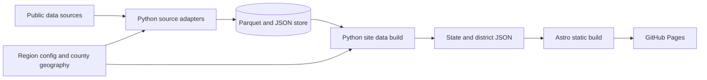

# Texas Ag Dashboard architecture

The dashboard is a static site with a scheduled data pipeline. Python fetches public data, keeps a history of observations, and turns that history into JSON for Astro. Astro reads the JSON during the build and publishes HTML, SVG, share images, and JSON to GitHub Pages. A page visit uses the published snapshot. Start with the [Quickstart](../QUICKSTART.md) to run it locally.

## Geography and configuration

Texas is the configured region. County FIPS codes join observations, geography, and county cards across the pipeline. The county table supplies names, district membership, centroids, and land area for all 254 counties. Each of the 15 NASS agricultural statistics districts has a page. The five featured districts appear in the header and first on the Texas page. A district's `crops` list selects which statewide crop series appear on its page. [Region loader](../kad/config.py) · [Texas configuration](../regions/tx.yaml) · [County table](../regions/tx-counties.csv)

The region YAML also defines the timezone, persona pages and card order, crop seasons, market report IDs, and source freshness and refresh settings. The checked-in county GeoJSON supplies boundaries for gridded rain and satellite data processing. The website draws its maps from `us-atlas` Census boundaries. The county scripts regenerate the table and GeoJSON when their inputs change. [Pipeline geometry](../regions/tx-counties.geojson) · [Map geometry](../web/src/lib/geo.ts) · [County table script](../scripts/make_county_table.py) · [County shapes script](../scripts/make_county_shapes.py)

## Ingestion and the data store

`python -m kad run` pulls recent data, runs annual work that is due, builds the public JSON, and prints a source report. `ingest` and `annual` run those refresh stages independently. `backfill` pulls about two years of drought and 60 weeks of auctions. Weekly NASS ingestion seeds five comparison years plus the current year, then reuses that baseline and refreshes recent years or catches up after a gap. The workflow's manual `backfill` option combines the historical pull with a forced run and a longer annual budget. [CLI](../kad/__main__.py) · [Update workflow](../.github/workflows/update.yml)

After ingest, `run` also scores outstanding Texas cotton harvest forecasts and issues a forecast when the latest fall USDA report has an upcoming target week. `snapshots/cotton_harvest.json` keeps one entry per target week, including both predictions, the inputs, and the first USDA result seen for that week. The same history survives every snapshot of the data branch. `harvest-backtest` compares the two methods on saved NASS data. [Harvest forecast](../kad/harvest.py) · [Forecast decision](decisions/0023-texas-cotton-harvest-outlook.md)

Each adapter handles its publisher's format and validation. The shared HTTP session uses HTTPS and retries transient errors. The CLI records adapter failures by source and continues with the other sources. A failed fetch can leave the previous successful data available until it ages out. [Adapters](../kad/adapters/) · [HTTP session](../kad/http.py)

| Regular refresh | What the adapter supplies |
| --- | --- |
| [U.S. Drought Monitor](../kad/adapters/usdm.py) | Weekly statewide and county percentages for cumulative drought categories. |
| [NASS Quick Stats](../kad/adapters/nass.py) | Statewide weekly crop progress, crop condition, and pasture condition. An `invalid query` response with HTTP 400 is how Quick Stats reports an empty result. |
| [AMS Market News](../kad/adapters/ams.py) | Statewide and selected local auction prices grouped into comparable classes, plus report narratives. The San Angelo sheep and goat report feeds Edwards Plateau and Cattle & Hay. |
| [Texas A&M Forest Service](../kad/adapters/burnbans.py) | A county burn-ban snapshot decoded from the publisher's KMZ style IDs. |
| [NOAA nClimGrid-Daily](../kad/adapters/nclimgrid.py), [NWS Stage IV](../kad/adapters/stage4.py), and [NWS forecast](../kad/adapters/nws.py) | County-average observed rain and temperatures, county rain estimates from radar and gauges, and seven-day forecasts sampled at county centroids, respectively. |
| [USDA APHIS](../kad/adapters/screwworm.py) and [Texas Boll Weevil Eradication Foundation](../kad/adapters/boll_weevil.py) | Validated Texas screwworm detections from a CSV and boll weevil monitoring by zone from a weekly PDF. The PDF adapter uses Poppler's `pdftotext`. |

The local store is `data/<region>/` by default. CI sets `KAD_DATA_DIR` to its `store` worktree and persists the result on the `data` branch. The main storage contract is a long Parquet table per source under `obs/` with `geo`, `var`, `date`, `value`, and `source`. A newer pull replaces matching `geo` / `var` / `date` rows so publishers' revisions carry through. `snapshots/` holds structured pulls and caches such as burn bans, auction narratives, and forecast grid URLs. The latest forecast lives in `forecast.parquet`, and `fetch_log.json` records successful pulls. [Storage code](../kad/store.py) · [Store path configuration](../kad/config.py)

### Annual sources and climate normals

The annual runner checks each source's `refresh_days` against its last successful fetch. Missing county coverage can make Cropland Data Layer (CDL) and Rangeland Analysis Platform (RAP) due early. The work shares a time budget. Completed portions are saved, and sources that are still due can resume later without a successful refresh being recorded for a partial result. [Annual runner](../kad/annual.py) · [Scheduling decision](decisions/0011-annual-sources-when-due.md)

| Source | What it adds |
| --- | --- |
| [NASS Census of Agriculture and county estimates](../kad/adapters/nass_annual.py) | County farm counts, land in farms, sales, livestock, and published crop acreage estimates. |
| [Cropland Data Layer via CroplandCROS](../kad/adapters/cdl.py) | Satellite-classified crop and land cover by county and year. |
| [Rangeland Analysis Platform](../kad/adapters/rap.py) | Annual rangeland cover and seasonal forage production. |
| [NOAA 1991–2020 climate normals](../kad/normals.py) | A resumable nClimGrid backfill produces daily normals and historical monthly rainfall under `normals/`. |

## From stored observations to site JSON

`python -m kad build` transforms the saved data without contacting the publishers. The build uses the region's local date by default. `--asof YYYY-MM-DD` helps exercise date-dependent behavior such as the NASS winter break. It operates on the current local store, including latest-only files such as forecasts and snapshots. [Build entry point](../kad/build.py)

- **Freshness.** Most sources age from the date of their newest figure. The last successful fetch is tracked separately. If figures are missing or stale, the relevant section drops its numbers. NASS crop cards can show an out-of-season state, and the configured winter pause is treated as between reports when a prior report exists. The boll weevil report ages from its report week. Screwworm ages from the last validated download, with warning and expiry times applied both during the build and in the browser. [Build rules](../kad/build.py) · [Screwworm card](../web/src/components/ScrewwormCard.astro)
- **Geographic rollups.** Statewide drought uses the published U.S. Drought Monitor state figure. District drought and rain use county land-area weighting, and district burn bans count counties. Weekly crop cards use the published Texas series. District annual crop acreage sums published county values and is labeled as a lower bound where coverage is incomplete. CDL figures are labeled satellite-classified. [Weekly build](../kad/build.py) · [Annual rollups](../kad/annual_build.py) · [Aggregation decision](decisions/0004-official-figures-first-districts-are-ours.md)
- **Weather.** Observed rain totals run through the newest nClimGrid day. Stage IV can fill the gap after that day with separately labeled estimates for completed days. Rain comparisons against normals and the running total since January 1 use nClimGrid observations. NWS supplies the forward-looking part of the weather strip. [Weather build](../kad/build.py) · [Stage IV decision](decisions/0017-stage4-rain-estimates.md)
- **Headlines.** Python turns available figures into plain-language sentences tagged by topic. Texas and district pages use these summaries, persona pages filter by relevant topics, and share cards can reuse the drought sentence. [Headline builder](../kad/headline.py)
- **Harvest outlook.** The build reads the issued forecast history without modifying it. It adds the active estimate, recent results, and aggregate live accuracy to `texas.crops.cotton.progress.harvest_outlook` in `latest.json`. The shared cotton card renders the estimate below the official figures while its input is current and the target report is due. The accuracy panel stays available after the estimate expires. [Harvest forecast](../kad/harvest.py) · [Outlook component](../web/src/components/HarvestOutlook.astro)

The build writes a region-wide file and one file per district under `web/public/data/<region>/`. [JSON reader](../web/src/lib/data.ts) · [TypeScript types](../web/src/lib/types.ts)

| Output | Contents |
| --- | --- |
| `latest.json` | Build date, source metadata and freshness, failed source keys, Texas indicators and headlines, persona settings, district summaries, markets, and county conditions keyed by FIPS. |
| `districts/<slug>.json` | District summary and drought history, weather strip, year-to-date rain, county cards with annual details, district annual rollups, and relevant markets. |

## From JSON to pages

| Route | What it renders |
| --- | --- |
| [`/`](../web/src/pages/index.astro) | Texas overview, county map, district links, weekly figures, and statewide context. |
| [`/district/<slug>/`](../web/src/pages/district/%5Bslug%5D.astro) | District conditions and annual figures. Map links target `#c-<fips>` and open the county's expandable card on the district page. |
| [`/for/<persona>/`](../web/src/pages/for/%5Bpersona%5D.astro) | The same published data, with cards selected and ordered by the persona's `card_order` in the region YAML. |
| [`/about/`](../web/src/pages/about.astro) | Publisher credits, sources, methods, and required notices. |
| [`/og/<name>.png`](../web/src/pages/og/%5Bname%5D.png.ts) | Build-time social previews, rendered with Satori and Sharp and referenced by page metadata. |

`Base.astro` owns shared navigation, metadata, the theme toggle, and the footer notice. `AsOf.astro` pairs figures with source and date labels, while `format.ts` owns display units and base-aware links. Components render maps and charts as SVG, with small browser scripts for interactions such as chart readouts and opening county cards. The theme and data colors live in `tokens.css`. [Shared layout](../web/src/layouts/Base.astro) · [As-of component](../web/src/components/AsOf.astro) · [Formatting](../web/src/lib/format.ts) · [Design tokens](../web/src/styles/tokens.css)

## CI, deployment, and health

GitHub Actions runs at 13:17 and 23:17 UTC, on qualifying pushes to `main`, and on manual dispatch. It restores the store, runs the Python tests, refreshes and builds the data, and saves the store as a single snapshot commit before the frontend build. It then runs Astro's type check and static build and tests the output with Playwright and axe on desktop and phone, including accessibility in both themes. Successful builds on `main` publish `web/dist` to GitHub Pages. PRs build and test against the saved store without live ingestion or deployment. `SITE_URL` and `SITE_BASE` control canonical and share URLs and must agree with the test configuration. [Workflow](../.github/workflows/update.yml) · [Astro config](../web/astro.config.mjs) · [Browser tests](../web/tests/site.spec.ts)

For an individual source, look at **Data sources this run** in the update job summary. It pairs fetch outcomes with the date and freshness of the figure that can be published. `python -m kad check` checks the two core sources, drought and weekly NASS data. The final health job flags stale core data and update or deploy failures. A freshness failure can coexist with a successful deploy of the sections that still have current data. [Run report](../kad/report.py) · [Health check](../kad/__main__.py) · [Troubleshooting](../QUICKSTART.md#when-something-breaks)

## Trace a number through the system

Follow the Blacklands drought percentage. The U.S. Drought Monitor adapter saves weekly county values in `obs/usdm.parquet`. The build selects the current map date, checks freshness, and weights county percentages by land area for the district summary. The result lands in `latest.json` and `districts/blacklands.json`. The district page reads the latter and shows `summary.drought.now.d1`, the district share in D1 or worse, alongside the map date and aggregation method. The statewide page gets its Texas percentage from the publisher's separate state series. [Adapter](../kad/adapters/usdm.py) · [Build](../kad/build.py) · [District page](../web/src/pages/district/%5Bslug%5D.astro)

When changing that path or adding a new source, follow the handoffs from source settings and adapter through storage, build, JSON types, page components, and attribution. The Python tests cover parsing and build rules. The browser tests cover what readers see in the resulting site. Record changes to this architecture in the same pull request. [Pipeline tests](../tests/) · [Browser tests](../web/tests/) · [Maintenance rule](../AGENTS.md)
